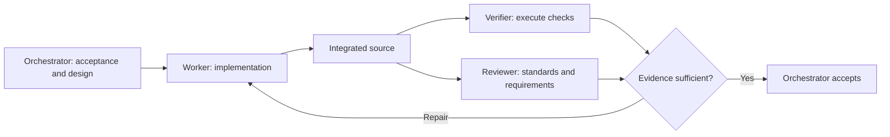

# Codex Dev Team

A reusable software-development workflow with a strong orchestrator, lower-cost
execution agents, and independent verification. Install it as a personal Codex
default while keeping each project's own instructions and required checks.



The orchestrator assigns exclusive file ownership, collects evidence, resolves
findings, and reruns checks invalidated by repairs. Expensive models stay focused
on decisions; scoped exploration and check execution use lighter models. A green
command is insufficient when tests were skipped or the runtime used stale code.

## Quick start

Use Python 3.11 or newer and a current Codex client with custom-agent support.
Download or clone this repository, then run these commands from its root:

```bash
python3 -m venv .venv
source .venv/bin/activate
python -m pip install -r requirements.txt
python scripts/setup.py plan
python scripts/setup.py install
python scripts/setup.py check
```

On Windows PowerShell, create the environment with `py -3 -m venv .venv` and use
`.venv\Scripts\python.exe` instead of `python`; activation is optional.

Inspect `team.toml` before installing and choose models available to your account.
The plan lists intended changes without writing them. Installation updates model
defaults, adds five custom agents, and appends a clearly marked instruction block.
It preserves unrelated settings and instructions. Restart with a fresh Codex chat
to load the complete setup, then describe a software task normally. An explicit
chat model selection or more-specific project configuration can override defaults.

## Model choices

`team.toml` is the source of truth for model names, reasoning, and concurrency.
The reference configuration is:

| Responsibility | Model | Reasoning |
| --- | --- | --- |
| Orchestrator | GPT-6 Astra | Extra high |
| `dev_worker` | GPT-6.1 Sol | Medium |
| `dev_reviewer` | GPT-6.1 Sol | High |
| `dev_explorer` | GPT-6 Luna | High |
| `dev_verifier` | GPT-6 Luna | High |
| `dev_deep_worker` | GPT-6.1 Sol | Extra high |

The default limit is three subagents, excluding the primary. Subagents are leaves.
Trivial, low-risk changes may stay in the primary. After two unsuccessful repair
attempts, the orchestrator escalates to the deeper worker or handles the issue.

For accounts that have GPT-6 Sol but not GPT-6.1 Sol:

```bash
python scripts/setup.py plan --models examples/team-gpt6-sol.toml
python scripts/setup.py install --models examples/team-gpt6-sol.toml
```

Or copy `team.toml` to the gitignored `team.local.toml`, edit it, and pass
`--models team.local.toml` to plan/install. An ordinary repeated installation is
idempotent; use the same model file when updating.

Model names are configuration, not an entitlement check. The installer does not
call a model, read credentials, or change authentication. Availability and
reasoning levels depend on the account, client, provider, and workspace. API-key
access does not prove access through a ChatGPT subscription. Confirm access with
your intended authentication before relying on a model. See the official
[model guidance](https://learn.chatgpt.com/docs/models?surface=app) and
[custom-agent documentation](https://learn.chatgpt.com/docs/agent-configuration/subagents?surface=app).

## What gets installed

The target is `$CODEX_HOME`, or `~/.codex` when that variable is unset. Use an
explicit target to inspect or test a separate installation:

```bash
python scripts/setup.py plan --codex-home /path/to/isolated-codex
python scripts/setup.py install --codex-home /path/to/isolated-codex
python scripts/setup.py check --codex-home /path/to/isolated-codex
```

| Path inside the target | Purpose |
| --- | --- |
| `config.toml` | Primary model, subagent defaults, enabled flag, concurrency cap |
| `AGENTS.md` | Managed pointer and standing delegation request |
| `agents/dev_*.toml` | Five role definitions with explicit model and reasoning |
| `dev-team/software-development.md` | Shared acceptance and verification standard |
| `dev-team/orchestration.md` | Dispatch, ownership, integration, escalation, acceptance |
| `.dev-team-state/` | Local restoration state; keep private and out of source control |

All installed references resolve within the selected target. Moving or deleting
the source repository after installation does not break the workflow. To relocate
the installed target itself, uninstall and reinstall at the new location.

The package contains no personal configuration, credentials, company-specific
instructions, customer fixtures, or required plugins. It does not change sandbox
or approval settings, configure MCP servers, or authorize deployment. Review and
verification roles' read-only behavior is an instruction, not a separate sandbox.

The installer refuses unmanaged collisions, symlinked managed files, malformed
configuration, or local changes to content it owns. Save those changes and resolve
the conflict before updating. Unrelated changes to settings and instructions can
remain. If you already have manually created `dev_*` agents, relocate those files
after backing them up before adopting this installer.

## Updates and removal

After updating this repository, preview and reinstall using your chosen model
file. To remove the package:

```bash
python scripts/setup.py uninstall
```

Use the same `--codex-home` if you installed to a custom target. Removal restores
the original managed settings and removes only this package's instruction block,
roles, and documents. It preserves later unrelated edits. Locally changed managed
content causes a conflict rather than being overwritten. Keep `.dev-team-state/`
until uninstall completes; it contains the restoration data.

Run one installer at a time and avoid saving Codex settings during installation.
Writes are staged and ordinary write failures trigger rollback; an abrupt process
termination or disk failure can require manual recovery. Keep your usual backup
of the target directory when upgrading an existing installation.

## Verification and contributing

```bash
python -m unittest discover -s tests -v
```

Tests use temporary target directories and do not invoke Codex or need credentials.
They cover install/update/remove behavior, preservation, model customization, and
conflict handling. GitHub Actions is configured for Linux, macOS, and Windows with
Python 3.11 and 3.13; only actual executed checks should be reported as passing.
See [VALIDATION.md](VALIDATION.md) for the initial package's executed checks and
remaining coverage limits.

For a live check, start a fresh Codex session in a disposable software project and
ask for one bounded change using `dev_worker`, followed by `dev_verifier` and an
independent `dev_reviewer`. Check actual test execution, source identity, findings,
and repair behavior. A successful spawn confirms an accepted role request; it does
not independently identify the backend model if your client omits that telemetry.

See [AGENTS.md](AGENTS.md) for contributor instructions. The model-independent
workflow lives in [assets/](assets/); role instructions live in [agents/](agents/).
This project is not an official OpenAI product. Licensed under [MIT](LICENSE).

## Share your copy on GitHub

Create an empty GitHub repository under your account or organization and choose
its visibility. If you downloaded a ZIP, extract it and initialize a checkout from
inside the extracted `codex-dev-team` directory:

```bash
git init -b main
git add .
git commit -m "Add portable Codex development workflow"
```

For an existing checkout, keep its commit history. Add your empty repository's URL
as `origin` and push `main` (use `git remote set-url origin ...` if a remote already
exists):

```bash
git remote add origin https://github.com/YOUR-ACCOUNT/codex-dev-team.git
git push -u origin main
```

Replace `YOUR-ACCOUNT` with the account or organization that owns your repository.
Share the resulting repository URL. Keep installed Codex configuration and local
restoration state outside the shared source tree.
